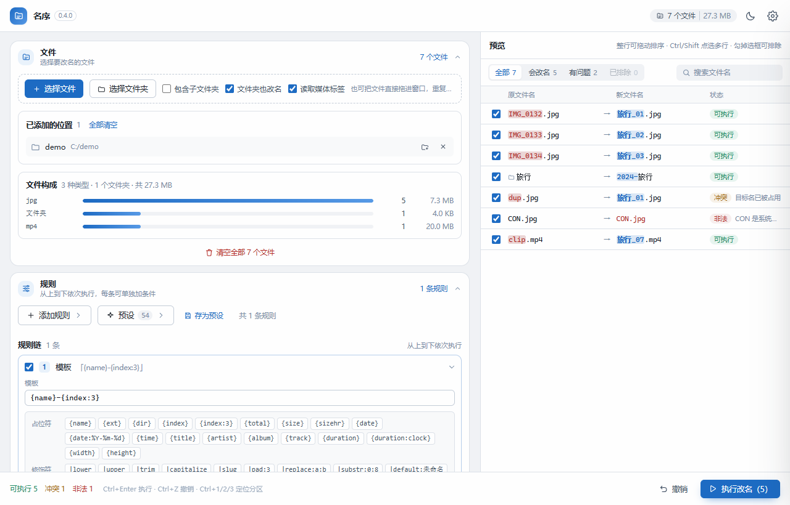
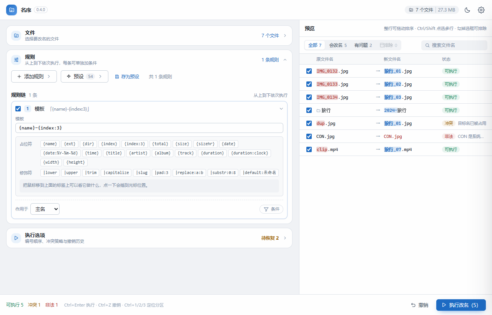
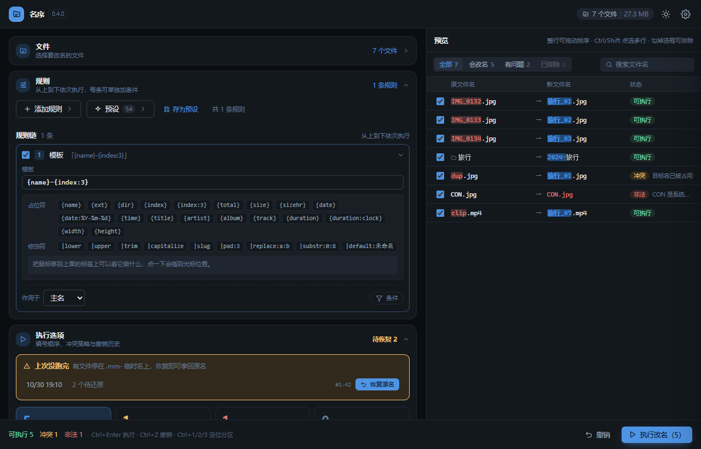
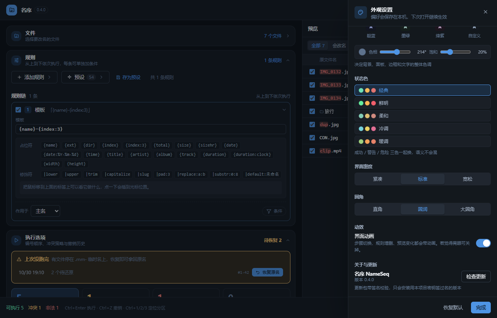
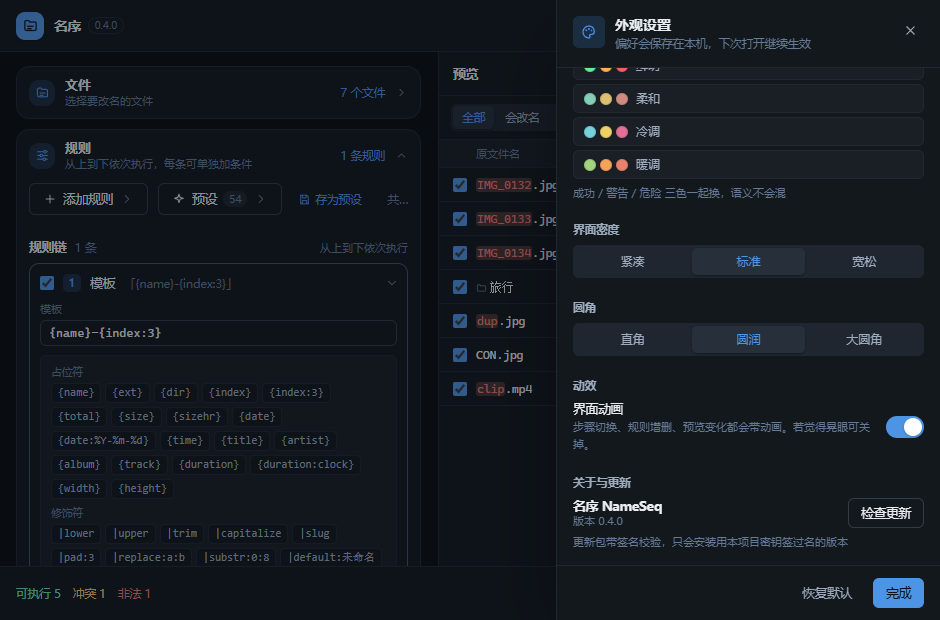

# 名序 · NameSeq

一个跨平台的批量重命名桌面工具，文件和文件夹都能改。核心引擎是纯 Rust，UI 是 React + Tauri 2，
安装包 1–5 MB 量级，几万个文件的列表也不卡。规则链能存成 `.nsq` 文件，同一份规则也可以交给
命令行（`nsq`）在脚本里跑。

功能上对标 Advanced Renamer / ReNamer 的思路：**有序规则链**——把替换、正则、序号、
大小写、日期等动作串成一条流水线，前一条规则的输出就是后一条的输入，每条规则还能加生效条件。

> 名字取「名 + 序」：给一堆乱糟糟的名字建立秩序。英文 NameSeq（name + sequence）。
> 两个字都常用，但「名序」这个组合在软件圈几乎无人占用——前一个名字「改名匠」
> 就常和其它改名工具撞车，这是改名的原因之一。
> 图标是 iOS squircle（超椭圆 n=5）+ 渐变底 + 右对齐递减的三根横条，「把名字排整齐」。

## 项目结构

```
.
├── crates/renamer-core/        # 纯 Rust 引擎，不依赖 GUI，可被 CLI / 服务复用
│   └── src/
│       ├── model.rs            # FileEntry / RenameOp / OpStatus
│       ├── rule.rs             # 规则链数据模型 + 14 种动作 + 条件过滤
│       ├── template.rs         # 占位符模板（规则链里的一种动作）
│       ├── chain.rs            # .nsq 规则链文件：版本、校验、导出/导入
│       ├── cn.rs               # 中文数字 ↔ 阿拉伯数字、汉字转拼音
│       ├── validate.rs         # NFC 归一化 + Windows 命名规则校验
│       ├── scanner.rs          # 并行目录遍历（jwalk）
│       ├── media.rs            # ID3 / FLAC / MP4 / JPEG-PNG 元数据（无第三方依赖）
│       ├── planner.rs          # 链式求值 + 计数器 + 冲突消解 + 自然排序/拼音排序
│       ├── executor.rs         # 两阶段改名 + 撤销 + 崩溃恢复
│       └── journal.rs          # JSONL 写前日志 + 完成标记 + 未完成检测
├── crates/nameseq-cli/         # 命令行前端（nsq），和界面共用同一份日志
│   └── src/main.rs
├── src-tauri/                  # Tauri 应用外壳
│   ├── src/commands.rs         # scan / plan / execute / undo / 恢复 + 进度事件
│   └── capabilities/default.json
├── src/                        # React 前端
│   ├── App.tsx                 # 布局骨架 + 状态编排
│   ├── i18n.ts                 # 语言表（中文原文即 key）+ t() 插值
│   ├── theme.ts                # 主题系统（HSL 通道 + 持久化）
│   ├── rules.ts                # 规则元数据：标签、分组、摘要、占位符与修饰符说明
│   ├── presets.ts              # 内置预设 + 用户预设（localStorage）
│   ├── renameApply.ts          # 执行/撤销后把新路径原地写回列表（不重扫）
│   ├── report.ts               # 执行前报告：预览清单 → CSV / Markdown
│   ├── util.ts                 # 体积格式化、文件名差异算法
│   └── components/
│       ├── TopBar.tsx          # 顶栏（含设置入口）
│       ├── FilesStep.tsx       # 文件分区：选文件（可折叠）
│       ├── RulesStep.tsx       # 规则分区：规则链 + 「添加规则」「预设」portal 浮层
│       ├── RunStep.tsx         # 执行分区：摘要 + 选项 + 撤销历史（可折叠）
│       ├── RuleEditor.tsx      # 可折叠规则卡片
│       ├── PreviewTable.tsx    # 虚拟滚动预览表（支持拖拽手动排序）
│       ├── SettingsDrawer.tsx  # 外观设置抽屉
│       ├── Toast.tsx           # 操作反馈
│       └── Icons.tsx           # 内联 SVG 图标
├── scripts/                    # 发版工具链（Node，零依赖）
│   ├── release.mjs             # 同步版本号 → 签名打包 → 收产物 → 写 latest.json
│   └── latest.mjs              # 自动更新清单：按目录里实际存在的 .sig 汇总平台
└── app-icon.png                # 图标源文件（1024²，squircle SVG 经 resvg 渲染）
```

## 界面设计

| 浅色 · 文件 | 浅色 · 规则 |
|---|---|
|  |  |

| 深色 · 执行 | 深色 · 外观设置 |
|---|---|
|  |  |

| 窄窗口（940×620）· 外观设置 |
|---|
|  |

界面是**单页三区**：功能区常驻一个页面，右侧预览常驻，不需要翻步：

```
┌────────────────────────────────────────────────────────┐
│ 顶栏：应用名 · 文件统计 · 明暗/设置快捷切换              │
├──────────────────────────────┬─┬───────────────────────┤
│ ▸ 文件（可折叠）              │ ║                       │
│   规则链（常驻展开）          │ ║   实时预览表           │
│ ▸ 执行选项（可折叠）          │ ║   （搜索 / 状态筛选）  │
│                              │ ║                       │
├──────────────────────────────┴─┴───────────────────────┤
│ 状态栏：可执行/冲突/非法计数 · 进度 · 撤销 · 执行改名     │
└────────────────────────────────────────────────────────┘
```

- **文件区**：添加入口收成**一行**（选择文件 / 选择文件夹 / 包含子文件夹），
  加完文件整个分区自动收起，标题行显示「N 个文件」——加文件这件事不值得
  占一大块版面；直接往窗口里拖文件永远可用，全窗口都有拖放提示
- **规则区**：主角，常驻展开；「添加规则」和「预设」是工具栏按钮，点开才弹浮层，
  用完即收（浮层用 portal 渲染，不会被任何滚动容器或折叠容器裁掉）
- **执行选项**：编号/冲突策略、撤销历史是低频配置，默认收起；标题行实时显示
  「可执行 N」，状态栏的「执行改名」按钮永远触手可及

预览始终在右侧，改规则的同时就能看到结果——这是这类工具唯一不能省的反馈回路。
三步向导看似有逻辑，实际用起来每换一步都要点一下，所以砍掉了：
`Ctrl+1/2/3` 现在是「展开并定位到对应分区」，不再是切换页面。

### 功能区 ↔ 预览可调宽

两个面板之间有一根分隔条（悬停显示强调色细条），**拖动即可重新分配宽度**：

- 功能区最窄 360px、预览最窄 260px，到界就推不动，谁也不会把谁挤没；
  窄到极限时按钮**高度不变、文字不错位**——空间不足先裁提示文字（省略号），
  按钮一律不换行
- 宽度实时生效并**自动记住**，窗口缩小时自动钳回有效范围
- **双击分隔条**恢复默认比例（预览约 40%）

### 手动排序

预览表里**整行都能拖**：按住行内任意位置（选择框除外）拖到目标行之间，出现强调色插入线后松手，
顺序立刻生效，「添加顺序」的编号跟着变。拖动的瞬间如果当前是其它排序方式，会自动切回
「添加顺序」并提示——不然拖了也白拖。过滤视图（按状态筛选 / 搜索）里行序和真实顺序对不上，
拖拽会自动禁用，避免误操作。长列表拖到上下边缘会自动滚动。

支持**多选拖拽**：普通点击单选，`Ctrl/⌘ + 点击` 切换选中，`Shift + 点击` 从上次点过的行
范围选择（锚点跟着行走，重排后依然正确）；按住任意选中的行拖动即整组移动。
不连续的多选拖到目标位置后会变成连续块，块内保持原来的先后顺序，插入线上会挂一个
数量角标提醒这次拖了几行。

拖动过程中**整张列表实时预览落点结果**——所有行平滑位移到「松手后」的位置，
所见即所得，松手零跳变。

### 改完名不重扫，列表原地更新

执行成功后列表不会重新扫描目录，而是按执行结果把每条路径原地换掉（`src/renameApply.ts`）。
重扫虽然也能拿到正确路径，但会顺手抹掉两样用户亲手做的选择——手动拖出来的顺序、
逐个文件点的排除勾选，大目录还要再等一次扫描。原地更新的代价是要自己处理路径映射，
两个坑都在这个文件里踩过了：

- **目录改名必须从深到浅替换前缀**。`A/B` 改成 `A2/B2`、`A` 改成 `A2`，先换子目录再换父目录；
  反过来父目录先换掉，子目录的旧前缀就不存在了，子项会漏改。前缀匹配还要按分隔符严格判定，
  否则 `A` 会误伤 `A2`。
- **替换是「并行」的，不能顺着映射链追到底**。同一批里 `a→b`、`b→a` 互换时，链式追下去会
  `a→b→a` 无限循环。唯一的例外是撤销/崩溃恢复——结果来自日志，中间夹着临时名
  （`原名 → .rnm-<批次>-<序号> → 最终名`），这一跳必须收掉，所以只允许穿过临时名做链式收敛。

撤销和崩溃恢复走同一套映射（结果里的 `from/to` 方向本来就是「新名 → 旧名」），
所以撤销完列表也不会重扫。

### 导出报告（交付与审计）

预览区右上角的「导出报告」把当前清单导成 **CSV** 或 **Markdown**——格式由保存对话框里
选的扩展名决定，一个按钮两种格式。列是：序号 / 状态 / 原文件名 / 新文件名 / 所在目录 /
大小 / 修改时间 / 说明。两份内容同源（同一个 `plan.ops`），不会出现「表格和文档对不上」。

为什么值得单独做：批量改名是「不可逆操作 + 需要留痕」的场景。用户经常要先把清单发给
同事确认、或者归档到项目记录里，以前只能截图。

格式上的几个必须：

- **CSV 带 UTF-8 BOM**。不带的话 Excel 双击打开中文列名全是乱码，而这是 Windows 用户的
  第一反应动作
- **按 RFC 4180 转义**：含逗号/引号/换行的字段加引号、内部引号翻倍
- **防 CSV 注入**：以 `=` `+` `-` `@` 开头的单元格加前导单引号。文件名以 `=` 开头时
  Excel 会当成公式求值——这是真会出事的一类问题
- **Markdown 转义 `|` 和换行**，否则表格被截断
- 目录条目的「大小 / 修改时间」显示 `—`：引擎本来就不记录它们（目录不参与漂移校验）

规则链（`.nsq`）和报告是两种东西，读者不同：`.nsq` 给名序自己回放规则用，
报告给人和审计看，所以报告**只导清单，不导规则**。

### 右键菜单

预览表的行上右键，常用操作都在：

- **打开文件**（系统默认程序）、**在资源管理器中显示**
- **复制原文件名 / 新文件名 / 完整路径**
- **排除 / 恢复**该文件
- 右键在选中的多选组上时，复制和排除按组批量执行（如「复制 3 个完整路径」）

打开与定位走 Tauri 的 opener 插件；复制走 Rust 端 arboard 命令，绕开
WebView2 的网页剪贴板权限限制。

实现上用的是**指针事件**（pointerdown/move/up）而不是 HTML5 拖放 API：
Tauri 的 WebView2 开着原生文件拖放时，页面内的 dragstart/drop 会被原生层吞掉，
而且行内拖动还会误触发整个窗口的「拖入文件」高亮——指针方案和文件拖放彻底解耦，两边互不干扰。

### 文件夹也能改

文件区里勾上**「文件夹也改名」**，扫到的子文件夹就会作为条目进入列表，和文件走同一条规则链；
`已添加的位置` 每一行上还有一个文件夹＋的小按钮，点一下把**那个文件夹本身**加进来
（不展开里面的内容，只改它自己的名字）。目录在预览表里带一个灰色文件夹图标，扩展名恒为空。

目录和「它里面的东西」不能同时改。判据很实在：改名是先把源挪到临时名、再落到目标名，
一旦先改了祖先目录，里面那些条目的**源路径**就失效了。所以规划阶段会按路径深度**从深到浅**
决定谁能改——凡是自己（或自己下面）有本批要改名的项，这条目录就标成冲突并写明原因，
其余照常执行。想连目录一起改，跑完这一批再执行一次即可（里面的文件已经改好，目录这轮就能过）。

### 崩溃了也能救回来

两阶段改名最怕的现场是：文件已经挪到 `.rnm-*` 临时名上，进程被强杀，用户打开目录看到一堆
看不出原本叫什么的东西。现在：

- 每一批**结束时写一条完成标记**；有日志、没完成标记、而且临时名文件还在磁盘上 = 上次被打断
- 启动时自动查一次（结果写进「执行选项」标题行的「待恢复 N」并弹提示），执行选项里给出
  批次列表和「恢复原名」按钮
- 恢复直接复用撤销的逆序逻辑：日志里有什么就逆推什么，缺的那几步（还没改）源文件不存在，
  逐条跳过并报告，不会动到已经还原的部分

扫描器也会跳过 `.rnm-*`，这些残留文件不会混进列表被二次改名。

### 动画都对应一个真实操作

没有纯装饰的动画，每一条都在回答「刚才发生了什么」：

| 操作 | 动画 | 想传达的信息 |
|---|---|---|
| 展开/收起分区 | 高度过渡（`grid-template-rows` 0fr→1fr） | 内容在展开，不是突然出现 |
| 添加规则 | 卡片下落 + 淡入 | 新规则加在了链尾 |
| 删除规则 | 先收起再左移淡出 | 卡片消失，后面的补位 |
| 展开/折叠规则 | 高度过渡（`grid-template-rows` 0fr→1fr） | 内容在展开，不是突然出现 |
| 改规则后结果变化 | 变化的行闪一次底色 | 是这几行的结果变了 |
| 拖文件到窗口 | 拖放提示层 + 添加行高亮 | 已经识别到拖放了 |
| 执行改名 | 进度条填充 + 相位文字 | 当前在做哪一步 |
| 切换主题 | 全局 260ms 颜色过渡 | 整体换肤，不是闪一下 |

所有动画在设置里可一键关闭，也自动尊重系统的 `prefers-reduced-motion`。

### 主题系统

颜色全部走 CSS 变量 + HSL 通道，切换主题只改 `<html>` 上的 `data-*` 属性和几个
通道变量，组件代码零改动。配色拆成四根独立的轴，各自可换、互不干扰：

| 轴 | 通道 | 可选 |
|---|---|---|
| 强调色 | `--a-h` / `--a-s` | 16 个预设（海蓝到靛墨）+ 色相/饱和度自定义滑块 |
| 浓淡 | `--a-mul` | 柔和 ×0.72 / 标准 / 鲜明 ×1.22，只缩放饱和度 |
| 界面色系 | `--n-h` / `--n-s` | 7 个预设（冷灰/暖灰/石墨/纯灰/靛蓝/墨绿/绛紫）+ 自定义 |
| 状态色 | `--ok-h/s` `--warn-h/s` `--danger-h/s` | 5 个方案，成功/警告/危险三色成组更换 |

面板、边框、文字、阴影的明度阶梯固定写在 CSS 里，色相和饱和度由通道注入——
所以换一套界面色系，整个界面（背景、卡片、输入框、滚动条、阴影）会一起换色调，
而不是只有几个按钮变色。深浅模式只是同一组通道换明度阶梯。

全部设置存 localStorage，通道数值在 `index.html` 里用一段内联脚本于首帧前写入
`<html>`（不查表，只读数字）——否则深色用户会先看到一帧白屏。

### 快捷键

| 键 | 作用 |
|---|---|
| `Ctrl/⌘ + Enter` | 执行改名 |
| `Ctrl/⌘ + Z` | 撤销最近一批 |
| `Ctrl/⌘ + 1 / 2 / 3` | 切换模块 |
| `Ctrl/⌘ + ,` | 打开外观设置 |
| `Esc` | 关闭设置抽屉 |

### 预设

内置 **54 条**常用规则链，按用途分成 5 组。预设面板不常驻版面——点工具栏的「预设」按钮才弹出，
选完自动收起，版面始终留给规则链。分组可以单独收起：

| 分组 | 数量 | 代表预设 |
|---|---|---|
| 编号排序 | 11 | 加序号 / 纯序号 / 从 100 开始 / 步长为 10 / 字母编号 / 带总数后缀 |
| 日期时间 | 8 | 日期+原名 / 按拍摄日期 / 精确到秒 / 中文日期 / 修改时间打头 |
| 字符清理 | 13 | 去相机前缀 / 去括号内容 / 去 emoji / 全角转半角 / 去重音符号 / 合并连续空格 |
| 格式转换 | 14 | 统一大写 / camelCase / snake_case / URL 安全名 / 大小写反转 / 只留字母数字 |
| 结构调整 | 8 | 模板带扩展名 / 目录名加原名 / 去掉尾部序号 / 去掉开头日期 |

保存自己的预设时可以选分组；所有内置预设的模板与正则都由 `cargo test` 里的
语法验证测试逐条编译，发布前就能发现写错的规则。

### 规则链可以存成文件（.nsq）

预设是存在本机的，换台机器就没了。**规则链导出**把「规则 + 条件 + 排序/编号策略」整个存成一个
`.nsq`（就是 UTF-8 的 JSON），可以在同事之间传、进版本库、或者交给命令行跑。
入口在「预设」浮层底部：导入 .nsq / 导出当前链，也可以直接把 `.nsq` 拖进窗口。

文件里有 `version` 字段，读到更新的版本会直接拒绝而不是「尽力读」——少读几个字段改出来的名字
可能是错的。打开时会顺手把每条规则编译一遍，第几条写错了当场指出来，不用等规划阶段。
当前批次里「排除勾选」属于这一批文件，不写进文件。

### 规则分组（整组停用 / 整组条件）

规则攒到十几条之后，麻烦的不是改名字，而是**临时关掉其中几条**——一条条取消勾选容易漏，
回头再勾回来更难。规则超过几条就可以在规则区上方的「分组」条里把它们打包：

- **整组停用**：勾掉组的开关，组内所有规则一次性跳过；规则卡片上会挂一个灰掉的「已停用」徽标，
  免得看见规则还勾着、却不起作用而困惑
- **整组条件**：给组设「只对 jpg 生效」这样的条件，组内规则自动只命中这些文件，
  不用给每条规则重复配一遍
- **删组不删规则**：分组只是贴在规则上的一个标签，删掉组之后规则原地保留、回到不分组状态
- **分组不改变执行顺序**：规则的上下次序仍然就是执行次序，`.nsq` 里 `rules` 依旧是平铺的数组，
  `groups` 只是贴在旁边的一张表，所以旧版没有 `groups` 字段的规则链照样能打开（全部视为不分组）

导出 `.nsq` 时分组一起带走；规则已经删空、没人引用的空组不写进文件，免得下次打开看到开关拨了没反应。

### 文件筛选与组合排序（预览上方）

预览列表上方有一条筛选栏，改哪一类文件不用去规则里加条件：

- **包含 / 排除**两种模式：包含 = 只改名命中的类型；排除 = 命中的跳过
- **预设类型**：视频、音频、图片、文档、压缩包、代码、文件夹——只显示这批文件里存在的类型，
  点一下整组选中；常用扩展名按类型分组点选（也只列这批文件里有的），还能手动输入
- **组合排序**：排序也在预览上方调整，主排序之外可以「再按」一个次级键——
  例如主键选「所在文件夹」+ 次键「文件名」，就是先按文件夹分组、组内按文件名排

### 多语言与更新体验

- **界面语言**：跟随系统 / 简体中文 / 繁體中文 / English / 日本語 / Español，
  默认跟随系统（不支持的语言回落英语），切换即时生效
- **检查更新**：频率可选（每次启动 / 每天 / 每周 / 仅手动），发现新版本后三选一——
  **更新**（下载并自动安装重启）、**仅下载**（装不装自己定）、**打开下载页面**；
  设置里还能看每版的 **Release notes**

### 占位符不用手打

「模板」规则里，占位符和修饰符都是可点的标签：

- **点一下插到光标位置**，不用记语法
- **鼠标移上去**，下方提示区实时显示它的作用、语法和结果示例
- 点完占位符紧接着点修饰符，会自动插进花括号里（`{name}` + `|lower` → `{name|lower}`）
- 光标不在占位符里时点修饰符，会补一个 `{name|xxx}` 出来，不会点出一段无效文本

「插入日期」规则的格式也是点选：`%Y%m%d` `%Y-%m-%d` `%Y%m%d_%H%M%S` `%Y%m` `%Y年%m月%d日` `%H%M%S`。

这些标签的定义在 `src/rules.ts` 的 `PLACEHOLDERS` / `MODIFIERS`，必须和
`crates/renamer-core/src/template.rs` 保持一致，否则界面上点出来的语法会被引擎判成未知修饰符。


## 四个关键设计

### 1. 规则链而不是单条模板

一批文件按顺序穿过所有启用的规则。每条规则由三部分组成：

- **作用目标**：主名 / 扩展名
- **生效条件**（可选）：扩展名、文件名正则、大小范围
- **动作**：13 种之一

好处是每个动作都很简单、能单独测试，组合起来却能覆盖绝大多数真实场景。
比如「只对 jpg、去掉 IMG_ 前缀、统一小写、再加序号」就是三条规则串起来。

### 2. 模板引擎是纯函数

解析一次得到 AST，渲染只做字符串计算，不碰文件系统。
预览和执行共用同一份计算结果，从根本上杜绝「预览显示 A、实际改成 B」。

### 3. 两阶段改名

一批文件的目标名可能互相占用（a→b 同时 b→c），甚至成环（a→b, b→a）。
逐个直接改必然失败，而且 Linux/macOS 的 `rename` 允许覆盖目标，会静默丢数据。

```
阶段一：a.txt -> .rnm-<batch>-0    （所有源文件先挪到同目录的临时名）
阶段二：.rnm-<batch>-0 -> b.txt    （临时名再落到最终目标名）
```

阶段一跑完，所有目标路径都已空出来，阶段二不可能撞车。

### 4. 写前日志 + 串行撤销

每一步都「先写日志再动文件」，日志落在系统应用数据目录的 `rename-journal.jsonl`。

撤销**不能**复用两阶段流程——撤销是一串有先后依赖的链式操作
（`a→t1`、`b→t0`、`t1→b`、`t0→a`），后一步要用的文件是前一步刚腾出来的，
只能严格按逆序串行执行。撤销本身也记成新批次，所以「撤销的撤销」就是重做。

日志还会在每一批**跑完时写一条完成标记**（`{"batch":…,"done":true}`，和步骤行写在同一个
JSONL 里，靠字段区分）。有步骤、没有完成标记、且临时名文件还在磁盘上，就说明这一批被中途打断——
启动时据此给出恢复入口，见前面「崩溃了也能救回来」。

## 规则类型

| 规则 | 说明 |
|---|---|
| **模板** | 占位符替换，见下节。功能最强，适合从零构造文件名 |
| **查找替换** | 支持字面替换和正则，可区分大小写 |
| **删除匹配** | 删掉匹配到的片段，支持正则 |
| **大小写** | 全大写 / 全小写 / 每词首字母 / 句首 / camelCase / snake_case / kebab-case / 反转 |
| **序号** | 独立计数器：起始值、步长、位数、进制（数字 / A B C）、插入位置、按目录重置 |
| **加前缀 / 加后缀** | 简单拼接 |
| **插入文本** | 插到第 n 个字符处 |
| **去首尾字符** | 默认去空白，也可指定字符集 |
| **字符清洗** | 全角转半角、去音标（é→e）、去 emoji、合并连续空格 |
| **插入日期** | 来源可选修改时间 / EXIF 拍摄时间 / 当前时间，格式用 chrono 语法 |
| **改扩展名** | jpeg → jpg，只作用于扩展名 |
| **截断** | 保留前 n 个或后 n 个字符 |
| **中文数字** | 中文 ↔ 数字：`第十二章` ↔ `第12章`（`二〇二四`、`廿三`、`一百零五` 都认） |

每条规则都可以加条件：只对某些扩展名、文件名匹配某正则、大小在某个范围。

### 中文场景

两件被英文工具忽略、但中文文件名天天遇到的事：

- **拼音排序**：`张三 / 李四 / 阿七` 按 Unicode 码位排是乱的，按读音才符合直觉。
  「排序依据」里多了一个「文件名（按拼音）」，`ZHANG` 会排在 `LI` 后面，和读出来的顺序一致
- **中文数字**：`第一章`、`第十二回`、`二〇二四年` 这类名字，和数字编号混在一起既排不好也编不了号。
  一条「中文数字」规则就能统一成 `第1章`（或反过来转中文）

顺带给了个 `{name|pinyin}` 修饰符，把中文名转成无声调拼音（`张伟` → `zhangwei`），
做网址安全名或跨平台文件名时不用再手敲。

拼音表用的是 `pinyin` crate（内置表，纯 Rust），数字转换是手写的状态机——只在 `cn.rs` 一个文件里。

### 关于正则捕获组

替换串里要用 `${1}` `${2}` 的写法。写成 `$1_` 会被正则引擎当成名为 `1_` 的组，
结果静默变成空字符串——这是最常踩的一个坑，UI 里也有提示。

```
查找  ^([0-9]+)-(.+)$
替换  ${2}_${1}
2024-trip.jpg  →  trip_2024.jpg
```

## 模板占位符（「模板」规则用）

| 占位符 | 说明 |
|---|---|
| `{name}` | 当前主名（会反映前面规则的结果） |
| `{ext}` | 扩展名 |
| `{dir}` | 所在目录名 |
| `{index}` `{index:3}` | 全局序号，默认从 1 开始，`:3` 补零到 3 位 |
| `{total}` | 本批总数 |
| `{size}` `{sizehr}` | 字节数 / 人类可读 |
| `{date}` `{date:%Y-%m-%d}` | 修改时间，默认 `%Y%m%d` |
| `{time}` | 修改时间，默认 `%H%M%S` |
| `{title}` `{artist}` `{album}` `{track}` | 音视频标签（需勾「读取媒体标签」） |
| `{duration}` `{duration:clock}` | 时长，默认秒数；`clock` 输出 `03-45` |
| `{width}` `{height}` | 视频 / 图片分辨率 |

修饰符用 `|` 串联，从左到右依次生效：

```
{name|lower}  {name|upper}  {name|trim}  {name|capitalize}  {name|slug}  {name|pinyin}
{name|pad:3}  {name|replace: :_}  {name|substr:0:8}  {name|default:未命名}
```

`{{` `}}` 输出字面花括号。

### 音视频标签是手写解析的

`{title}` 这类占位符要读文件头，所以文件区里是**按需开启**的（「读取媒体标签」，默认关）——
几万个文件时不读标签，扫描只碰目录项，速度不受影响。

解析器在 `crates/renamer-core/src/media.rs`，只用标准库：

| 格式 | 读什么 | 怎么读 |
|---|---|---|
| MP3 | 标题/艺术家/专辑/音轨 | ID3v2.2/2.3/2.4 文本帧，读不到退到文件尾的 ID3v1 |
| FLAC | 同上 + 时长 | VORBIS_COMMENT + STREAMINFO 的采样率与总采样数 |
| MP4 / M4A / MOV | 同上 + 时长 + 分辨率 | 按偏移递归走盒子：mvhd / tkhd / udta-meta-ilst |
| JPEG / PNG | 宽高 | SOFn 段 / IHDR |

不引第三方库是有意的：格式规则很稳定，而多一个依赖就多一份体积和跨平台编译风险。
视频只读元数据盒，不碰像素数据，几百 MB 的文件也是毫秒级。

读不到就留空——某个文件没有标签，不应该让整条规则链算不出结果，靠 `|default:` 兜底即可
（`{artist|default:未知歌手} - {title}`）。

## 常用组合示例

| 想要的效果 | 规则链 |
|---|---|
| 加序号 | 模板 `{name}-{index:3}` |
| 照片按拍摄日期 | 插入日期(EXIF, `%Y%m%d`, 位置 0) → 加后缀 `_` → 序号(3 位) |
| 去掉相机前缀 | 删除匹配 `IMG_` |
| 空格转下划线 | 查找替换 ` ` → `_` |
| 每个文件夹单独编号 | 序号规则勾选「每个目录重新计数」 |
| 只改图片不动视频 | 任意规则 + 条件「只对扩展名 jpg,png」 |

## 冲突处理

目标名被占用时有两种策略：

- **跳过**（默认）：标记为冲突，不执行，预览里能看到是哪一条
- **自动加 (1)(2)**：`a.txt` 已存在就改成 `a (1).txt`，直到不冲突

注意「同批内互相占用」不算冲突——比如 1.txt→2.txt 而 2.txt→3.txt，
两阶段改名天然能处理，不会丢数据。

## 大批量先问一句

改动超过 **200 项**时，「执行改名」会先弹一个确认框，写清数量并提醒先看预览。
阈值取 200 的理由很实际：一屏预览看得到十几行，再多就不可能逐条核对了，
这时候「确认」才不是走过场。撤销能整批回滚，但用户按下按钮那一下往往已经慌了。

## 失败要说得清，还要能重试

批量改名失败是常态：文件被播放器占着、只读属性、目标名刚被别的程序占了、预览之后文件被改过。
以前只有一句「改名失败」，用户不知道该关哪个程序。现在失败会**分类**，每类给一句能照做的建议：

| 分类 | 触发 | 建议 |
|---|---|---|
| 被占用 | Windows 共享冲突 / 锁冲突（os error 32、33），Unix EBUSY | 关掉正在用它的程序再重试 |
| 没权限 | 只读属性、ACL、目录不可写 | 检查只读属性与目录权限 |
| 源已不在 | 源文件被移动/删除 | 刷新文件列表重新规划 |
| 目标被占 | 执行那一刻目标名被别人抢了 | 改用「自动加 (1)(2)」 |
| 文件被改过 | 预览后文件的大小/时间变了 | 重新预览后再执行 |
| 名字太长 | 路径超过系统上限 | 缩短规则输出 |

执行失败后「执行选项」会**自动展开并滚到失败卡片**（不再只弹一个 toast），卡片按原因归类、
列出具体文件，右下角一个「重试这 N 个」。重试不是简单重跑：后端会先用**当前磁盘状态**刷新每条
记录的 `size + mtime` 再走完整的两阶段流程——否则上次因为「被改过」失败的文件会被同一个漂移
校验再拦一次，重试永远失败。

分类还回答了「重试有没有意义」：被占用、没权限、被改过的可以重试；源文件没了、目标被占、
名字太长的得先改点什么，这类条目的按钮不会给用户虚假的希望（`retryable` 字段）。

## 已处理的跨平台坑

- **Unicode 归一化**：macOS 返回 NFD，Windows 返回 NFC，`é` 一个字符两个码点。所有文件名比较前统一转 NFC。
- **大小写不敏感文件系统**：`a.txt → A.txt` 靠临时名中转才能成功，且不会被误判成「目标已存在」。
- **Windows 保留名与非法字符**：`CON` `PRN` `AUX` `NUL` `COM1-9` `LPT1-9`、`<>:"/\|?*`、结尾的点和空格。规划阶段就拦住。
- **路径长度**：Windows 超过 260 字符时提前报警。
- **符号链接**：默认跳过，不跟随目录链接（避免死循环）。
- **预览与执行之间的漂移**：执行前复核 `size + mtime`，被外部改动过的文件跳过并报告。
- **覆盖保护**：阶段二落地前检查目标是否存在，避免 Linux/macOS 静默覆盖。
- **单文件失败不中断整批**：错误逐条收集，最后统一汇总。
- **目录改名的路径失效**：先改祖先目录，里面条目的源路径就没了。规划阶段按深度从深到浅判定，
  含「本批要改名的子项」的目录自动跳过并说明原因。
- **崩溃残留**：临时名文件不进扫描结果；启动时按日志 + 完成标记找回被打断的批次。

## 开发

```bash
npm install
npm run tauri dev        # 开发模式
npm run tauri build      # 打包
```

只跑引擎测试（很快，不需要编译 Tauri）：

```bash
cd crates/renamer-core && cargo test    # 引擎：125 个
cd crates/nameseq-cli && cargo test     # 命令行：8 个（含真跑一遍改名→撤销）
```

引擎当前 125 个测试：112 个单元测试 + 13 个集成测试（10 个端到端：真实文件系统上跑扫描→规划→
执行→撤销→崩溃恢复；3 个预设语法验证）。命令行另有 4 个参数解析单测 + 4 个端到端（临时目录里
真改名、真撤销、坏规则链的退出码）。

### 多语言的写法

gettext 风格：**简体中文原文就是 key**，`t("已添加 {n} 个文件", { n })` 直接写在渲染处，
`src/i18n.ts` 里只有 `zhTW` / `en` / `ja` / `es` 四张表（中文即兜底，不单独建表）。

这么写的好处是代码里读到的就是用户看到的话，不用在「文案」和「键名」之间来回查。代价是
**漏词条不报错**——查不到就静默回落中文，界面上会混出半中半英。所以补了上面那三个测试守着。

两条容易踩的约束：模块级的常量表（`ACTION_LABELS` 这类）**不能**在定义时调 `t()`，因为语言要
运行时才确定，只能在渲染点包一层（`t(ACTION_LABELS[k])`）；数据表文件（`rules.ts` / `theme.ts` /
`presets.ts` / `fileTypes.ts`）里的中文本身就是 key，属于测试白名单的例外。

### 前端纯函数测试（`npm run test:unit`）

```bash
npm run test:unit
```

同样零依赖，用 Node 22 的 TS 类型擦除直接 import `src/` 里的模块，不需要编译。
`tests/unit/loader.mjs` 是个 20 行的解析钩子，把 `src/` 里 Vite 风格的无扩展名导入
（`from "./i18n"`）补成 `.ts`——不给测试让步去改业务代码的写法。

| 文件 | 管什么 |
|---|---|
| `renameApply.test.mjs` | 执行后「把新路径写回列表」：目录前缀替换的边界（`A` 不能波及 `A2`）、互换改名不能死循环、撤销日志里的临时名两跳要收成一跳 |
| `report.test.mjs` | 报告文本格式：CSV 的 BOM / RFC 4180 转义 / 防公式注入，Markdown 的竖线与换行转义 |
| `latest.test.mjs` | 自动更新清单：三平台齐全时各有一条、Windows 用 NSIS 而不是 msi、签名取自 `.sig`、`--mac-arch` 决定 darwin 键名、缺 `.sig` 的平台不算、notes 沿用旧清单 |

### 界面回归（`npm run test:ui`）

```bash
npm run test:ui
```

零依赖：Node 22 自带 WebSocket，直连 Chrome DevTools；vite 用编程式 API 起在随机端口，
每个测试文件自己启一个 headless Chrome，跑完就关。本机需要 Chrome，不在默认路径时用
`CHROME_PATH` 指定。

| 文件 | 管什么 |
|---|---|
| `smoke.test.mjs` | 页面能挂载、启动时按预期调用后端、加文件后预览表出行 |
| `layout.test.mjs` | 从实测最小宽度扫到 1600：所有按钮/勾选框高度必须不变、不被裁切；最窄时关键行不溢出 |
| `interaction.test.mjs` | 拖拽排序、分区折叠、切换语言后不残留中文 |
| `execute.test.mjs` | 执行改名后列表原地更新：顺序不变、被排除的保持原名、不触发重新扫描 |
| `report.test.mjs` | 导出报告接线：按钮可用、按扩展名分流、写出去的内容和预览逐行一致 |
| `i18n.test.mjs` | 源码里每条 `t("…")` 在四张语言表里都有译法（纯静态，不开浏览器） |
| `i18n-hardcoded.test.mjs` | 反向守门：源码和 JSX 里不许有漏包 `t()` 的中文文案（自带词法，能跳过注释、字符串、正则字面量） |
| `i18n-english.test.mjs` | 真起一个英文界面，扫页面上残留的中文——静态测试看不见运行时才拼出来的文案 |

`layout.test.mjs` 是这套的重点：窄窗口下按钮变形/遮挡历史上返工过五六次，现在用「全宽度枚举 +
跨宽度比对」把它钉死——新增控件不用改测试，只要它变形就会被抓出来。

i18n 三件套是一组，缺一不可：**查覆盖率**（每条 `t()` 都有译法）、**查漏包**（源码里不许有裸中文）、
**查运行时**（英文界面上真的看不到中文）。原因很实在——词条缺失是**静默回落中文**的，不露键名、
不报错，只有测试能把这种「翻了一半」拦在发版前。

CI（`.github/workflows/ci.yml`）三个 job：Windows 上跑两个 crate 的 `cargo test`，Ubuntu 上跑
`tsc --noEmit` + 前端纯函数测试 + `vite build`，Windows 上再跑一遍界面回归（布局测量受字体和
滚动条影响，必须在目标平台跑）。

## 发布

版本号散在 4 个文件里（`package.json`、`tauri.conf.json`、两个 `Cargo.toml`），手改必漏。
一条命令搞定：

```bash
npm run release 0.6.0 -- --build --notes "修了中文排序"
```

它会：① 同步 4 处版本号（只改版本那一行，不重新格式化 JSON，diff 干净）→
② 带签名私钥打包 → ③ 把安装包、`.sig` 和 `latest.json` 收进 `dist-release/`。
本机只出得了本平台的包，所以这份清单是单平台的；三平台齐全的那份由 Release CI 汇总生成。
把 `dist-release/` 里的东西传上去就能被老版本客户端「检查更新」看到。

更新服务器的地址用 `NSQ_UPDATE_BASE` 覆盖，默认按 GitHub Release 的路径拼接。

### 自动 Release（GitHub Actions）

打一个 `vX.Y.Z` 的 tag 推上去，CI 会在三个平台**并行构建**，再由一个汇总 job 建唯一一个 GitHub Release。
分成两段是因为 `latest.json` 必须同时包含三个平台的条目，而三个构建 job 互相看不到对方的产物：

```
build（matrix: windows / macOS / linux）→ 各传一份 artifact
        ↓ needs
publish（ubuntu）→ 下载全部 artifact → 合并生成 latest.json → 建 Release 并上传
```

```bash
git tag v0.9.1 && git push origin v0.9.1
```

**发版说明的写在哪**：`latest.json` 的 `notes`（客户端「检查更新」里显示的更新内容）
取自注解标签的消息，没有注解标签就取版本提交的正文。所以要么

```bash
git tag -a v0.9.3 -m "改完名不再重扫目录；新增导出报告" && git push origin v0.9.3
```

要么让版本提交的正文就是发版说明（本仓库一直这么写）。两样都没有的话，
更新提示会是空的——`v0.9.2` 就踩过这个坑，之后已修。

| 平台 | runner | 产出 |
|---|---|---|
| Windows | `windows-latest` | `nameseq_X.Y.Z_x64-setup.exe`（NSIS）、`nameseq_X.Y.Z_x64_zh-CN.msi`、`nameseq_X.Y.Z_x64_portable.zip`、以及对应 `.sig` |
| macOS | `macos-latest` | `nameseq_X.Y.Z_aarch64.dmg`、`.app.tar.gz`、`.sig` |
| Linux | `ubuntu-latest` | `nameseq_X.Y.Z_amd64.deb`、`.rpm`、`.AppImage`、裸二进制 `nameseq-linux-x64`、`.sig` |

`latest.json`（自动更新清单）由汇总 job 用 `scripts/latest.mjs` 生成：它扫目录里实际存在的
`.sig` 文件，谁在就给谁写一条，所以少一个平台也不会写出个指向空文件的条目。平台键名按 Tauri
的约定拼（`windows-x86_64` / `darwin-aarch64` / `darwin-x86_64` / `linux-x86_64`），macOS 的
架构由 `--mac-arch` 指定。本地 `npm run release` 也走同一个函数，只是目录里通常只有本平台产物，
所以生成的是单平台清单——三平台齐全的那份由 CI 产出。

签名私钥走仓库 secret `TAURI_SIGNING_KEY`（= 本地 `.keys/nameseq.key` 全文），
workflow 里用 libsodium sealed-box 加密写入，CI 不会明文接触它。

**已知限制**：**macOS 未签名/未公证**。GitHub 的 macOS runner 没有 Apple 开发者证书，出的 dmg
是未签名的，用户首次打开会被 Gatekeeper 拦（右键 → 打开可绕过）。要消除需另配 Apple 证书 secret
（`APPLE_CERTIFICATE` / `APPLE_CERTIFICATE_PASSWORD` / `APPLE_API_KEY` / `APPLE_API_ISSUER`），
后续可补。

## Windows 构建产物

```bash
npm run tauri build
```

产出（`src-tauri/target/release/`）：

| 文件 | 大小 | 用途 |
|---|---|---|
| `nameseq.exe` | ~6.6 MB | 免安装单文件，双击即用 |
| `bundle/msi/nameseq_0.9.1_x64_zh-CN.msi` | ~3.3 MB | 企业分发 / 组策略部署 |
| `bundle/nsis/nameseq_0.9.1_x64-setup.exe` | ~2.5 MB | 普通用户安装包（推荐） |
| `bundle/nsis/…setup.exe.sig` | 436 B | 更新包签名，配合 `latest.json` 校验 |

另外 `cd crates/nameseq-cli && cargo build --release` 会产出 `nsq.exe`（3.4 MB，含拼音表），
它不进安装包——命令行工具单独分发，服务器上也不需要图形环境。

体积比 0.3.0 大了约 1.5 MB，全部来自更新能力：`tauri-plugin-updater` 需要 HTTPS 客户端
（reqwest + rustls），这部分没法按需裁剪。0.5.0 又多了拼音表（crate 内置二十多万条读音），
换来的是中文排序和 `{name|pinyin}`，值。

几点实际注意事项：

- **依赖 WebView2 Runtime**。Windows 11 和 Win10 1803+ 已内置，老系统需要用户先装。
  若要覆盖老机器，把 `bundle.windows.webviewInstallMode` 改成 `embedBootstrapper` 或 `offlineInstaller`（体积会涨 100 MB 以上）。
- **未做代码签名**，首次运行时 SmartScreen 会提示「Windows 已保护你的电脑」，需点「更多信息 → 仍要运行」。
  正式分发建议买 OV/EV 证书。
- **安装包语言必须显式配成中文**，否则 MSI 打不出来：
  WiX 默认用 `en-US` 本地化，数据库代码页是 1252，遇到产品名里的中文（名序）
  会直接报 `LGHT0311: A string was provided with characters that are not available
  in the specified database code page '1252'`，`light.exe` 链接失败，整个 bundle 步骤中断
  （NSIS 也就一起没生成）。所以 `tauri.conf.json` 里必须有：

  ```json
  "bundle": {
    "windows": {
      "wix": { "language": "zh-CN" },
      "nsis": { "languages": ["SimpChinese"], "displayLanguageSelector": false }
    }
  }
  ```

  `zh-CN` 走 936 代码页，中文才写得进去。
- release 配置开了 `lto` + `codegen-units=1` + `opt-level="s"` + `strip` + `panic="abort"`，
  所以二进制才 4 MB 左右。代价是首次全量编译约 4–5 分钟。

## 命令行（nsq）

界面里调好的规则链，同一份文件可以交给命令行跑：脚本、定时任务、CI 都行。

```bash
cd crates/nameseq-cli && cargo build --release     # 产出 target/release/nsq.exe

nsq run 照片编号.nsq ./photos -r -n     # 预演：只打印计划
nsq run 照片编号.nsq ./photos -r -y     # 真执行（-y 表示不再问）
nsq batches                            # 看历史批次
nsq undo                               # 还原最近一批，也可跟批次号
```

选项：`-r` 递归、`-d` 文件夹也改名、`-m` 读媒体标签、`-n` 预演、`-y` 不再确认、`-q` 少打印。

几个刻意的设计：

- **日志和界面共用一份**（`%APPDATA%\com.nameseq.app\rename-journal.jsonl`），
  所以 CLI 改的名字能在界面里撤销，反过来也成立。测试和便携场景可以用 `NSQ_JOURNAL` 覆盖路径
- **没加 `-y` 就会问一句**，非交互环境读不到输入就直接取消——不会「静默改一堆文件」
- **退出码**：0 正常、1 有文件失败、2 参数或规则链有问题，方便脚本判断
- 失败也会按上面的分类打印建议（「关掉正在用它/预览它的程序」），日志里一眼能看出该做什么
- 空目录时会提示「递归模式要加 -r」，而不是默默输出「0 项」

## 自动更新

用官方的 `tauri-plugin-updater`，签名私钥在 `.keys/nameseq.key`（已被 `.gitignore` 忽略，
丢了就再也签不出能被旧版本接受的更新包，务必自己备份）。

```bash
# 生成密钥（只需一次，已有就跳过）
npx tauri signer generate -w ./.keys/nameseq.key -p "" --ci
```

平时发版不要手敲下面这条，直接用 `npm run release <版本号> -- --build`（见上一节「发布」），
它会自己带上私钥、收产物、生成 `latest.json`。等价的底层命令是：

```bash
TAURI_SIGNING_PRIVATE_KEY="$PWD/.keys/nameseq.key" \
TAURI_SIGNING_PRIVATE_KEY_PASSWORD="" npm run tauri build
```

公钥写在 `tauri.conf.json` 的 `plugins.updater.pubkey` 里，`endpoints` 默认指向
`https://github.com/yunyu697/nameseq/releases/latest/download/latest.json`——换成自己的地址即可。
`latest.json` 的格式就是官方那套（版本、平台、url、signature）。不用手写——`scripts/latest.mjs`
扫目录里实际存在的 `.sig`，按平台各写一条：url 指向同名安装包，signature 就是 `.sig` 的内容。
要单独生成时：

```bash
node scripts/latest.mjs --version 0.9.3 --dir dist-release --notes "发版说明"
```

客户端在设置抽屉最下面：「检查更新」→ 有新版就在后台下（带进度）→ 装完自动重启，
Windows 上走 passive 安装（静默装，只留一个进度条）。签名不匹配的包会被拒装，
所以更新通道不会成为后门。

## 打包前必须处理

1. **图标已全套生成**：`app-icon.png` 是源图（iOS squircle 轮廓 + 渐变 + 排序横条），
   `npx tauri icon app-icon.png` 一条命令产出 ico / icns / 各尺寸 png。改图标只改源图重跑即可。
2. **代码签名**：macOS 需要 Apple Developer 账号（$99/年）+ 公证 + hardened runtime；
   Windows 没证书会被 SmartScreen 拦。这是目前唯一还缺的一环。
3. **自动更新已接入**：私钥在 `.keys/nameseq.key`，打包命令要带上
   `TAURI_SIGNING_PRIVATE_KEY`，否则 `createUpdaterArtifacts` 会失败。发布时把
   `latest.json` 和安装包一起放上更新服务器。

## 还没做的

- 在线试用：把引擎编成 WASM，浏览器里直接试规则，不用先下载安装
- 大目录性能基准：5 万文件的扫描 / 规划耗时曲线，作为后续优化的基线
- macOS 签名与公证：目前出的包未签名，用户要右键绕过 Gatekeeper（见「自动 Release」）
